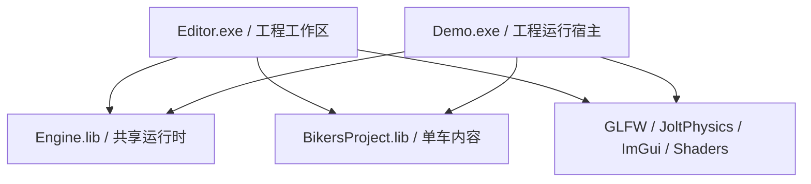

# Engine、Editor、Demo 构建目标

`premake5.lua` 是构建归属的唯一配置源。解决方案包含 Engine、BikersProject、Editor、Demo 四个主要目标，以及 GLFW、JoltPhysics、ImGui 和 Shaders 依赖目标。配置只有 Debug / Release；原 Game 配置不再承担产品选择。

| 目标 | 编译归属 | 初始化行为 |
| --- | --- | --- |
| Engine | 通用 Runtime、blank 通用场景入口、场景文档加载和共用第三方实现；排除两个入口、具体关卡、车辆控制器、Demo HUD 和启动画面 | 提供通用场景能力，由宿主选择入口；不指定游戏启动 UI/音效资源 |
| BikersProject | level1、TestScene、bikeController、GameUi 和 `Source/Projects/Bikers` 工厂 | 为两个宿主提供同一场景、HUD、UI 和音频配置 |
| Editor | `Source/Applications/Editor/Main.cpp` | 默认未保存通用工作区，可保存为 `.steerproj` 并 Play；打开工程后使用通用场景或原生内容模块 |
| Demo | `Source/Applications/Demo/Main.cpp` 和 StartupSplash | 运行通用场景工程或原生关卡；原生模块提供自己的游戏 UI；不提供 F1 编辑器入口 |

现有内容源文件仍可位于 Runtime 目录，构建归属由明确的文件清单决定。例如 `Runtime/Scene/level1.cpp` 只由 BikersProject 编译，两个宿主均链接这份内容实现。

## 宿主契约

`ApplicationOptions` 由可执行入口创建，持有场景工厂、窗口标题、布局文件、编辑器和 Runtime UI 能力，以及 HUD 配置、UI 预加载、音效初始化/更新回调。Application 不再 include level1，也不再存放 BikeChain 或 MainMenu 等资源路径。

启动和重开始终调用同一个场景工厂；重开也重新调用同一音效初始化回调。原有 `FrameScheduler`、状态重置与失败恢复协议保持统一。工厂缺失或返回空场景会明确报错。

Renderer 通过 `SetGameHudCallbacks` 接收内容模块的绘制/重置函数；共享的 `SceneViewport` 只存放画布位置、尺寸和 draw list。GameUi 的具体实现由 BikersProject 持有。编辑器可用性使用运行时能力开关，避免共享库与入口使用不同 `GAME_ONLY` 宏而产生不一致的 inline 定义。

原生 Bikers 工程布局保存到 `.steer/Editor.ini`、`.steer/Demo.ini`；通用工程布局位于配套 `<工程名>.steer/Editor.ini`、`Runtime.ini`；空工作区仍使用 `Intermediate/Layouts/Editor.ini`。两个入口均可通过 `--project` 指定 `.steerproj`，按该文件解析资源根。详见 [工程工作流](Projects.md)。

Editor 默认显示空工作区时，Inspector 和拾取路径会遇到实体 ID 0。统一的 `IsEntityAlive` 检查会先排除空句柄，再查询 Flecs，避免 Debug 首帧因空选择触发断言。

## 输出与验证

- Engine 静态库：`Intermediate/Bin/<配置>-x64/Engine/Engine.lib`。
- 单车内容库：`Intermediate/Bin/<配置>-x64/BikersProject/BikersProject.lib`。
- 可执行文件：`Bin/<配置>-x64/Editor.exe`、`Demo.exe`。
- 目标与配置分别拥有独立的 Intermediate/Obj 目录；不同配置不会覆盖可执行文件。
- Visual Studio 默认启动 Demo；选择 Editor 启动项目进入编辑工作区。

`Tests/Build/verify-targets.ps1` 读取真实生成的 vcxproj/slnx，验证目标类型、源文件归属、依赖方向、公共编译宏/include、配置与产物路径隔离，以及默认启动目标。CPU 行为回归继续使用 `Tests/State`、`Tests/UI`、`Tests/Gameplay` 的真实生产实现。

## 当前仍共享的部分

Engine 中仍编译 EngineUi、UIEditorWindow、ImGuizmo、通用 UI 渲染器及 Runtime UI 路由；Renderer 目前直接使用这些共用设施。Demo 关闭编辑器入口不等于删除了编辑器机器码。UserState 中的游戏状态契约和 SceneManager 中少数车辆专用规则也仍需后续分离。此次完成的是可独立构建、链接和启动的目标，以及可执行程序对具体内容的所有权。
