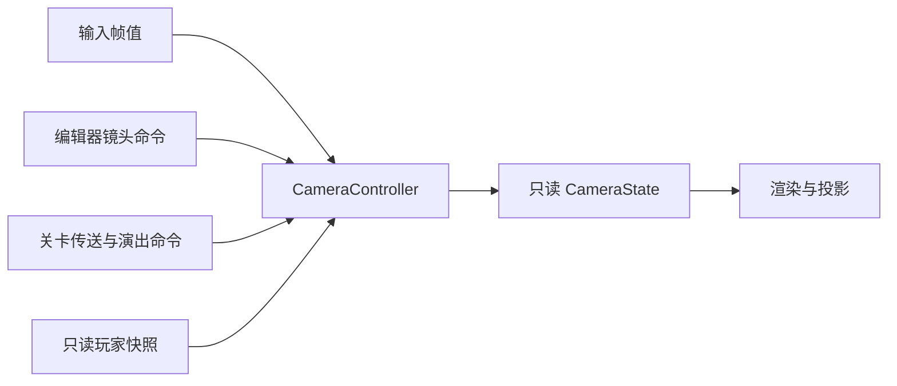

# 第 3–6 步：状态分组、控制入口、帧调度与生命周期

本文件记录当前实现；`StateOwnership.md` 保留最初的字段盘点和迁移来源。`UserState` 现在只作为 Application 的组合根，不再继承 `GameplayState`，也不再作为通用可写参数传给各个系统。

## 状态与所有者

| 分组 | 所有者及写入方式 | 场景重开 |
| --- | --- | --- |
| `gameFlow` | GameFlowController，命令与重载完成协议 | 保留进行中的重载事务 |
| `player` / `PlayerState` | PlayerController；外界只有 `const State()` | 重置生命、能力、统计和运动快照 |
| `camera` / `CameraState` | CameraController；外界发送模式、镜头及接管命令 | 重置镜头、接管和平滑历史 |
| `level` | 当前关卡；收集、电台和传送表现等本局数据 | 重置 |
| `hud` | HudController；游戏帧发布速度、距离、计时等 HudData | 清零本局统计 |
| `vehiclePresentation` | 游戏侧生成只读 SceneEffects；含速度、死亡和传送裁剪输出 | 重置效果及计时 |
| `preferences` | 已应用的游戏偏好，例如提示显示 | 保留 |
| `render` | 用户画质、后处理与渲染设置 | 保留 |
| `renderOverrides` | 关卡的临时环境覆盖，目前是 IBL | 清除，恢复用户偏好 |
| `capabilities` | 渲染设备能力，UI 只读 | 保留 |
| `renderStats` | 渲染统计，UI 只读 | 清零后重新计算 |
| `editor` | 编辑器面板、视口模式与工具状态 | 保留工作区；清场景粒子选择和悬停 |
| `runtimeUi` | 运行时界面的显示策略 | 保留，流程切换仍同步菜单 |

`UserState::ResetSession()` 按这些分组重置，替代整份 `UserState{}` 赋值。音量仍由 AudioSystem 单独保存恢复。历史上未接通的 `BikeTuning` 已在第 6 步移除。无消费者的旧鼠标坐标和 `wasMousing` 已移除，鼠标捕获只由 InputSystem 持有。

## 模块实际获得的权限

| 接口 | 能读写什么 |
| --- | --- |
| `GameplayState` 引用上下文 | 流程、玩家及相机命令，关卡数据、HUD/车辆表现控制器和环境覆盖；游戏偏好只读，没有编辑器工作区或用户画质写权限 |
| `SceneStateView` | 只读帧执行快照、玩家、相机、渲染设置和编辑器调试参数 |
| `RendererStateView` | 玩家、HudData、SceneEffects 及帧执行快照只读；不再接收 LevelState；相机命令、渲染与编辑器状态；流程和偏好引用用于转交 Runtime UI |
| `RuntimeUiStateView` | 流程命令、只读玩家、游戏偏好、界面显示；没有相机或关卡修改接口 |
| EngineUi 各面板 | 按面板传入 EditorState、RenderSettings、只读统计/能力或 CameraController；不再接收 UserState |
| GameUi HUD | 只读 HudData、视口尺寸及局部纹理解析回调；不依赖 RenderSystem、PlayerState 或 Vulkan |
| BikeController | PlayerController、输入和 Jolt；没有相机或编辑器状态 |
| PhysicsSystem | 不再保存从未使用的 UserState/InputSystem 指针 |

这些 view 是对 Application 所拥有对象的引用，不复制运行状态，也不拥有生命周期。重置状态值后，引用仍指向同一组成员对象。

## 玩家控制

`PlayerController` 负责死亡、复活、控制使能、能力解锁、运动快照和死亡表现计时。`Die()` 幂等，只在首次死亡时累计死亡次数；`Respawn()` 不改变游戏流程，也不能通过切换镜头调用。

BikeController 保留实际物理驱动，把踩踏历史、驱动力和转向/倾斜缓存收进私有成员。死亡、复活、传送和控制禁用通过 `motionResetRevision` 通知它清理旧驱动历史，避免复活后旧倾斜或踩踏状态重新写回。

每帧物理更新后，Application 调用 `GameScene::RefreshPlayerMotion()`，由 BikeController 发布真实位置和水平速度。死亡或演出禁用控制时仍更新运动反馈。极速判定沿用 36 m/s 阈值，由 PlayerController 派生，与相机模式无关；触发器使用玩家真实位置。

死亡特效由 Application 在允许模拟时调用 `UpdateEffects(dt)` 推进，Renderer 只读最终系数。角色倒地仍区别于整个游戏流程的 GameOver。

## 相机控制



- 基本模式是 Follow / Free。T 键与相机面板只请求模式切换，不复活玩家，也不通过模式决定能否骑行。
- Portal 临时接管镜头，完成或取消后恢复进入前的基本模式。立即传送与延迟穿越均由控制器处理，关卡提供空间变换请求。
- Cinematic 优先级最高；进入时取消旧 Portal，并保存基本镜头。演出期间普通模式请求和手动变换不能覆盖演出镜头；退出后恢复保存的镜头。关卡独立禁用/恢复玩家控制。
- 火箭胜利结束时释放演出控制，结算背景保留最后镜头；下一局由场景重置恢复默认跟随。
- `SetOrbit`、`SetFov`、`SetFreeTransform` 是编辑器的修改入口。手动 FOV 会保持，只有显式启用 Automatic FOV 才恢复距离/极速映射；Free 模式同样应用 FOV 平滑。
- `camera.cpp` 只负责把 InputSystem/视口信息转换为 `CameraInput`，以及读取 CameraState 生成渲染 uniform；相机计算不依赖 UserState、ImGui 或 Vulkan。
- 主菜单和暂停期间，编辑器仍能调整基本 Follow/Free 镜头；游戏模拟及 Portal/Cinematic 的时间保持暂停。角色在 Portal 中死亡时，游戏先取消该接管再申请死亡镜头。

关卡不再直接赋值 `camera2world`、轨道结果或相机内部计时，编辑器也只读当前输出并提交目标。

## 验证与后续边界

状态/控制器测试编译真实 CPU 实现，验证生命与镜头隔离、运动反馈、手动镜头、临时接管及会话重置；既有 UI 流程测试继续覆盖真实资源、Router 和 UIManager。

从仓库根目录运行：

```powershell
powershell -NoProfile -ExecutionPolicy Bypass -File Tests/State/run-controller-tests.ps1
powershell -NoProfile -ExecutionPolicy Bypass -File Tests/State/run-scene-frame-tests.ps1
powershell -NoProfile -ExecutionPolicy Bypass -File Tests/UI/run-game-flow-tests.ps1
powershell -NoProfile -ExecutionPolicy Bypass -File Tests/UI/run-runtime-ui-flow-tests.ps1
powershell -NoProfile -ExecutionPolicy Bypass -File Tests/UI/run-runtime-ui-flow-tests.ps1 -GameOnly
powershell -NoProfile -ExecutionPolicy Bypass -File Tests/EditorUI/run-trigger-binding-tests.ps1
powershell -NoProfile -ExecutionPolicy Bypass -File Tests/Gameplay/run-hud-tests.ps1
powershell -NoProfile -ExecutionPolicy Bypass -File Tests/Gameplay/run-vehicle-presentation-tests.ps1
powershell -NoProfile -ExecutionPolicy Bypass -File Tests/Gameplay/run-frame-presentation-tests.ps1
```

自动回归包括状态/调度 13 组、GameFlow 7 组、UI Editor 与 GameOnly 各 9 组、真实 ECS 帧更新 3 组，以及触发器 10 组、HUD 8 组、车辆表现 7 组、游戏表现帧集成 5 组。调度测试直接调用生产 `FrameScheduler`；集成测试将真实触发器、HUD 和车辆表现控制器接入该调度，验证跳过呈现、暂停、结算及重载的行为。这些测试没有创建真实游戏窗口，未覆盖 GPU 实机交互验收。

`run-scene-frame-tests.ps1` 另外创建真实 Flecs world，覆盖暂停/恢复、菜单/设置和重载完成帧；普通 ECS 系统和定时器在停止帧不运行，编辑器变换仍可传播。该套件直接调用生产 `SceneFrameUpdate.hpp`，同样不创建窗口或 GPU。

## 输入路由与帧阶段

Application 使用 `Core/FrameScheduler.hpp` 固定执行顺序，系统注册顺序只负责初始化与逆序释放，不再隐式决定更新顺序：

1. `InputSystem::Update()` 在帧起点调用 `glfwPollEvents()`，更新键盘、鼠标、滚轮和手柄快照。
2. `FrameScheduler::BeginFrame()` 提交上一帧收集的流程请求；若进入 Loading，则消费一次重载并报告真实结果；最后发布 `UserState::frame`。玩家输入门禁在此之后计算，使用新帧的模拟许可。
3. `FrameScheduler::Execute()` 依次运行关卡、事件、物理、物理反馈与触发器、场景变换、动画、游戏表现数据、呈现、音频。关卡、事件、物理、反馈、动画和游戏表现数据都使用同一帧快照；场景、呈现、音频在暂停时仍被调用，内部的模拟部分也读取同一快照。
4. SceneManager 的物理同步、场景触发器与游戏表现数据阶段、Renderer 的游戏相机和粒子模拟，以及车辆音频采样均使用 `frame.runSimulationSystems`，不再各自查询实时 `CanSimulate()`。HUD 和速度/传送效果计时已移到游戏阶段。编辑器基本 Follow/Free 相机在暂停期间仍能调整；重载完成帧禁止推进它，避免旧输入影响新镜头。

`GameFlowController::Request()` 的返回值表示请求是否被接受，不表示流程已经切换。请求按待提交状态依序验证，例如同帧 Pause + OpenSettings 合法，重复 Pause 被拒绝；普通查询只读已提交状态。`PendingState` / `PendingSettingsOpen` / `PendingReloadTarget` 仅供命令决策与 UI 资源预载使用，不能用于本帧系统门禁。

生产代码只有 `FrameScheduler::BeginFrame()` 调用 `CommitPendingRequests()`、`TakeReloadRequest()` 和 `CompleteReload()`。一批有效请求只发布一次 Revision；UI 根据已提交 Revision 换屏。例如关卡在帧 N 提出 Victory，帧 N 的物理、变换、动画和渲染模拟完整执行，帧 N+1 才统一停止并显示胜利页。重载完成帧即使流程已经是 Playing，也保持所有模拟门禁关闭，下一帧才恢复。

暂停与重载完成时，`SceneFrameUpdate.hpp` 只显式运行变换传播系统，不调用整个 Flecs `world.progress()`。这样既可显示编辑器变换，也不会推进普通 ECS 玩法系统或按原始时间工作的定时器；仅传 `dt=0` 或设置 `time_scale=0` 均不足以保证这一点。

编辑器在 ImGui 帧中发布捕获信息，Application 使用上帧键盘捕获与视口悬停屏蔽玩家输入。Renderer 的快捷键和相机仍有各自的焦点判断；鼠标捕获归属的完整统一留待输入路由进一步整理，当前 `inputCapturesMouse` 尚没有消费方。玩家输入阻止与世界模拟暂停保持独立。本次只统一流程提交和帧执行依据，不将这些焦点判断描述为已经完全统一。

## 生命周期清理

第 6 步将会话状态和进程/编辑器状态分开处理：

- `ReloadCurrentScene()` 继续调用 `UserState::ResetSession()`，只重置玩家、相机、本局关卡、HUD/车辆表现、临时环境覆盖、渲染统计和场景选择；画质、设备能力、游戏偏好和编辑器布局保留。
- 输入边沿、鼠标增量、滚轮累加器和手柄快照在重载后由 `InputSystem::ResetForNewSession()` 清理，避免重开瞬间重复触发按键动作。
- MenuBack/Esc 统一读取 InputSystem 的按下边沿；删除 Renderer 自有的 `mMenuBackWasDown` 和原始 GLFW 补充查询，避免重开后重新解释仍按住的 Esc。
- 关卡检查点/电台冷却从函数静态变量改为关卡成员，并在 Init/Shutdown 中清零。HUD 统计和车辆效果在 `ResetSession()` 中清零；调试选中项与纯 UI 平滑值仍在渲染侧场景临时资源清理时清零。
- 删除没有消费者的 `BikeTuning` 配置及其奖励写入，避免留下看似可调但实际无效的旧入口。

自动回归覆盖暂停与设置组合、胜利/失败后的重开、Runtime UI 与编辑器状态隔离，以及重开保留画质和编辑器布局。输入边沿接入已做源码核查；实际 GLFW 输入、视口焦点切换和完整 GPU 交互仍需真实窗口验收。

## 场景渲染与编辑器边界（第一阶段）

当前已把两类职责从 `RenderSystem` 的直接调用中收出：

- `SceneRenderSource` 是场景世界向渲染器提供批次、骨骼批次、灯光和裁剪统计的只读接口。`SceneManager` 实现该接口，但渲染器不再依赖这些 ECS 查询的具体实现。
- `EditorSceneAdapter` 持有编辑器选中对象和拾取入口。选中状态不再是 `RenderSystem` 的字段；编辑器仍可通过原有 UI 参数接收选中 ID，因此本阶段不改变面板行为。
- 游戏视口和编辑器视口继续使用同一个 `m_sceneViewportTexId`。编辑器 UI 只显示渲染器提供的场景纹理，并通过适配器提交拾取操作，避免单独复制一套场景绘制逻辑。

这一阶段已经继续收口编辑器修改入口：可见性、变换、物理同步、删除和拾取由 `EditorSceneAdapter` 提交；`EngineUi` 保留布局和控件绘制，不再直接负责这些写操作。`SceneRenderer` 现在统一代理主视口、传送门视口、骨骼批次和灯光数据准备，仍不拥有 Vulkan 资源。

编辑器层级树、内容浏览器的资源加载以及粒子面板仍需要更细的适配接口；GPU 命令录制和交换链生命周期也仍由 `RenderSystem` 管理。这些是后续继续缩小 `RenderSystem` 公开接口的边界。

## 触发器、车辆表现和 HUD 的游戏侧归属

`GameScene` 持有自己的 `TriggerSystem`。物理反馈发布真实玩家位置后，Application 调用 `UpdateTriggers()`；触发器只依赖标准库与 GLM，无粒子组或未绘制画面也能执行。进入/离开回调与粒子可见性输出分开处理，多触发器共用粒子组时取 OR；单次完成或禁用仍保留绑定所有权并输出 inactive。删除粒子组会先重排绑定；场景析构解绑调试绘制、粒子删除及两个所有权查询回调。

`level` 和 `TestScene` 在动画后的 `gameEffects` 阶段调用 `BikersPresentation`，发布 `HudData` / `SceneEffects`，并解析 Demo 球棒的粒子位置绑定。空场景不使用这套 Demo 规则，球形发射器可以使用自己的位置。粒子面板和 gizmo 读取通用 `scenePositionControlled` 标志，不再根据形状猜测游戏绑定。

`VehiclePresentation` 解释玩家速度、死亡系数和关卡穿门状态，输出通用的裁剪平面、空间映射、目标 entity/body ID 与后处理参数。`SceneRenderer` 只据这些数据处理静态与蒙皮批次；主视口和传送门视口共用同一份未裁剪克隆来源。Renderer 不再查找 `Bike_0`、`BaseballBat.nails_0` 或读取 LevelState。

`HudController` 在每个模拟帧累计距离和计时，暂停保持、重开重置。物理速度单位是 m/s，HUD 统一转换为 km/h / mph，距离直接使用 m/s × dt。旧 HUD 的单位标签也改为 km/h。`GameHudBindings` 仅将快照写入 Runtime UI 数据上下文，多次绘制不会多计时。能量仍是 Demo 的速度派生显示，圈数和最佳圈时间也仍是占位逻辑，未引入新的体力或比赛系统。

这些游戏数据在调用 Renderer 前完成，所以交换链获取失败或跳过呈现不会漏掉玩法更新。GPU 粒子更新/上传仍由 Renderer 管理；粒子本身的完整模拟拆分、车辆物理和 SceneManager 中剩余的车辆专用逻辑不属于本次边界。

## 独立 Editor / Demo 宿主

构建目标现已分为共享 Engine、BikersProject 静态库和独立 Editor / Demo 程序，详见 `BuildTargets.md`。两个入口通过 `ApplicationOptions` 提供场景工厂，Application 的启动与重开统一调用该工厂。Demo 读取 `.steerproj` 并通过 BikersProject 创建 `level`，加载关卡、车辆、触发器和游戏菜单。

Editor 未打开工程时使用 `blank` 显示空工作区。打开 Bikers 工程后，由同一内容库创建完整场景。`EditorPlayController` 在统一帧边界处理 Play / Pause / Stop；编辑态和编辑器暂停态通过 `FrameScheduler` 关闭玩法、物理和游戏动画，编辑相机、场景变换传播和渲染继续工作。工程开关在当前帧结束和旧 Application 析构后完成，资源目录与 UI 缓存一并切换；具体流程见 `Projects.md`。

Play 保留原编辑世界及其物理、音频、动画和场景 GPU 资源，在同一窗口创建运行实例；Stop 销毁运行实例并恢复原编辑世界，不通过磁盘快照覆盖未保存改动。已有实体按完整路径匹配，同步变换、启用状态、灯光及物理参数；新增/删除实体与任意组件结构尚未实现完整复制。Jolt 全局类型注册由两个物理世界共同持有，最后一个世界关闭时才释放。

Scene / Game 是同级标签，共用一个渲染目标；Scene 使用 `EditorState::sceneCamera`，Game 使用游戏相机。Game 标签可见、获得焦点且鼠标位于视口或被捕获时，才接受玩家输入。文字编辑和弹出菜单屏蔽游戏键盘输入；切换视口释放鼠标捕获。游戏 HUD、菜单与点击坐标限制在 Game 画布内。游戏的退出操作请求 Stop，独立 Demo 中仍然退出程序。

编辑器 Pause 与游戏菜单暂停各自保留状态：Resume 只解除编辑器门控，不强行关闭游戏菜单。宿主音频静音独立于用户音量。Play 会重新加载模型和纹理，当前并非即时世界克隆，Debug 下加载可能较长。
