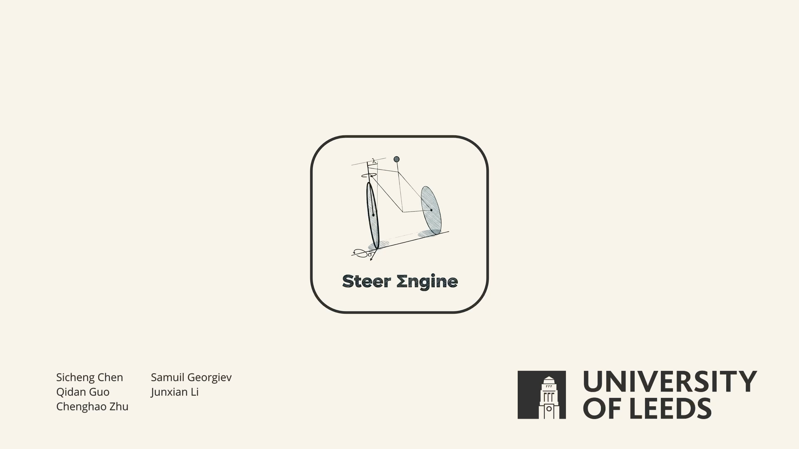

# Steer Engine

**A Performance-Focused ECS Engine for Vehicular Action Games**

Steer Engine is a custom high-performance game engine built entirely in C++. Designed from the ground up to eliminate the overhead of monolithic toolsets, it leverages the explicit graphics control of Vulkan, the rigorous data-locality of Flecs ECS, and the deterministic physical simulation capabilities of Jolt Physics. 

The engine currently powers a fast-paced bicycle action game requiring high-speed collision resolution and physics-driven mechanics.

## Core Technologies

* **Language**: C++
* **Graphics API**: Vulkan (Dynamic Rendering)
* **Architecture**: Flecs (Entity-Component-System)
* **Physics**: Jolt Physics
* **Audio**: Miniaudio
* **UI/Tooling**: Dear ImGui

## Building on Windows

Install Visual Studio with the **Desktop development with C++** workload and a Windows SDK. Run the bundled Premake from the repository root in PowerShell:

```powershell
# Visual Studio 2026 (v145 toolset)
.\premake5.exe vs2026
```

Open (or reload) `EngineWorkspace.slnx` in Visual Studio 2026, select `Debug | x64`, and build the solution. `Debug` and `Release` are build configurations; Editor and Demo are separate application targets. The default startup project is **Demo**.

| Target | Responsibility | Debug output |
| --- | --- | --- |
| Engine | Shared static runtime library; no application entry point or concrete demo scene | `Intermediate/Bin/Debug-x64/Engine/Engine.lib` |
| BikersProject | Native Bikers scene, vehicle, HUD and project configuration shared by both hosts | `Intermediate/Bin/Debug-x64/BikersProject/BikersProject.lib` |
| Editor | Project workspace, editor panels and free camera | `Bin/Debug-x64/Editor.exe` |
| Demo | Runs the selected Bikers project with game menus and splash screen | `Bin/Debug-x64/Demo.exe` |

Release executables use `Bin/Release-x64`. Both applications link the same Engine and BikersProject libraries for their configuration. The bundled `glslc.exe` compiles shared shaders automatically. Project-relative paths are resolved from the `.steerproj` file; Editor and Demo save separate layouts in the project's `.steer` directory. The empty editor uses `Intermediate/Layouts`.

```powershell
# Run the game demo after building Debug.
.\Bin\Debug-x64\Demo.exe
# Run the standalone editor.
.\Bin\Debug-x64\Editor.exe
# Verify generated project ownership and dependency boundaries.
powershell -NoProfile -ExecutionPolicy Bypass -File Tests/Build/verify-targets.ps1
```

Select **Editor** as the startup project to debug editor work. The previous `Game` configuration and monolithic `Bin/Engine.exe` output have been replaced by these named targets; an old `Bin/Engine.exe` left by an earlier build is not updated.

This step separates build ownership and application composition. Shared ImGui/editor implementations and some game-oriented runtime state remain in Engine; Demo disables editor access at runtime but is not yet an editor-free distribution. See [build boundaries](Docs/BuildTargets.md) for the exact scope.

For Visual Studio 2022, use `.\premake5.exe vs2022` and open `EngineWorkspace.sln`; this requires the v143 C++ toolset. An MSB8020 error naming v143 means that toolset is missing. If using Visual Studio 2026 with v145, regenerate with `vs2026` instead of editing generated project files. Regenerate after changing `premake5.lua` or switching Visual Studio versions.

## Opening the Bikers project

In Editor, choose **File > Open Example Project**, or **Open Project...** and select `Projects/Bikers/Bikers.steerproj`. The complete level opens with simulation stopped and a free editor camera. The top **Play / Pause / Stop** controls run the game inside the peer **Game Viewport** tab; Stop restores the editable scene and its unsaved changes. **Scene Viewport** retains its own editor camera. Scene and Game share one rendering surface and switch as tabs. **Project > Run Saved Project in Separate Window** remains available for a standalone Demo. **Save Scene Snapshot** persists existing named-entity transforms and particle settings; adding/deleting models is not yet part of scene serialization.

```powershell
.\Bin\Debug-x64\Editor.exe --project .\Projects\Bikers\Bikers.steerproj
powershell -NoProfile -ExecutionPolicy Bypass -File Tools/Package-BikersProject.ps1
```

The package in `Intermediate/Packages/Bikers` contains its own Assets and project content source. Its `.steerproj` can be opened from another directory with this editor. The native Bikers module is compiled into the hosts; changing C++ requires rebuilding, and opening a project does not load arbitrary DLLs. See [project workflow](Docs/Projects.md).

## Technical Highlights

| Subsystem | Key Capabilities |
| :--- | :--- |
| **Renderer** | Physically Based Rendering (PBR), Cascaded Shadow Maps (CSM), Screen Space Reflections (SSR), SSAO, and multi-pass Bloom. |
| **Architecture** | Pure ECS paradigm ensuring high-performance entity management with negligible CPU bottlenecks and optimized memory contiguity. |
| **Physics** | Jolt Physics integration featuring a specialized Vehicle Constraint system for robust and tunable bicycle control alongside deterministic rigid-body resting states. |
| **Tooling** | Custom UI framework leveraging ImGui for real-time visibility into ECS states, rendering batches, and specialized runtime debugging. |
| **Assets & Animation** | Dynamic GLTF model loading and native support for complex humanoid skeletal animations using compute skinning and Inverse Kinematics. |

## Project Media

### Engine Showcase Video
[](https://youtu.be/cVQpITH5PKc)
*Click the image above to watch the full high-resolution engine showcase.*

### Academic Poster
[](./Docs/SteerEnginePoster.pdf)
*Click the image above to view the full PDF poster.*

### Full Technical Documentation
[Read the full Steer Engine Group Report (PDF)](./Docs/Rafael_s_Bikers-2.pdf)

***
*Developed by Sicheng Chen, Samuil Georgiev, Qidan Guo, Junxian Li, and Chenghao Zhu under the supervision of Rafael Kuffner dos Anjos at the University of Leeds.*
